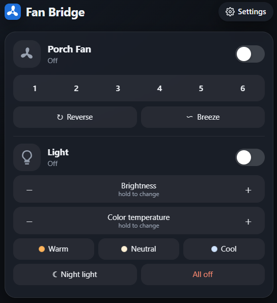
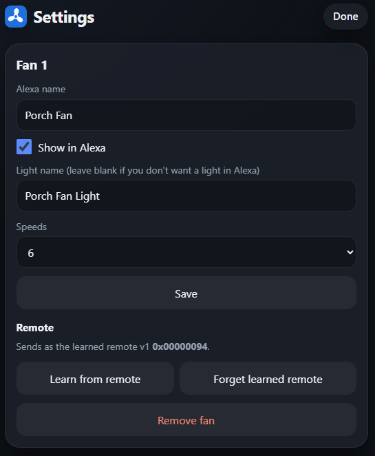

# BLE Fan Bridge

**Local Alexa and phone control for FanLamp Pro Bluetooth ceiling fans, with no cloud, no app account and no hub.**

```
Echo ──WiFi──▶ ESP32 (pretends to be a Philips Hue bridge) ──Bluetooth LE broadcast──▶ fan(s)
                 ▲
     phone / PC ─┘  web page at http://<board-ip>/
```

Many cheap DC ceiling fans (sold under various brands, and controlled by the **FanLamp Pro** app or a small BLE remote) listen for Bluetooth advertising packets. This firmware turns a ~$10 ESP32 board into a bridge that:

- shows up in **Alexa** as a dimmable device per fan, with on/off and speed by percent, plus an optional on/off device for the light;
- serves a **phone-friendly web page** with every button the remote has: six speeds, reverse, breeze, the light, hold-to-dim, color temperature, warm/neutral/cool, night light and all off;
- can **learn your existing remote**. The board copies the remote's identity, so it controls exactly the fans that remote controls, and the remote keeps working. This is the only practical option when several fans share one wall switch.

Everything runs on your local network. No Amazon skill, cloud service or account is needed.

<table>
  <tr>
    <td align="center"></td>
    <td align="center"></td>
  </tr>
  <tr>
    <td align="center"><sub>Control page</sub></td>
    <td align="center"><sub>Settings</sub></td>
  </tr>
</table>

> **Status:** a personal project, tested on two Crazypai 52" DC fans with their "TYX" BLE remotes (FCC ID 2BHLF-TYX0004), an ESP32-CAM board and Echo devices. Other FanLamp-family fans and remotes will probably work, especially with **Learn from remote**, but haven't been tested. See [Compatibility](#compatibility).

## Contents
- [Hardware](#hardware)
- [Install and flash](#install-and-flash)
- [First-time setup](#first-time-setup)
- [Adding fans](#adding-fans)
- [Using it](#using-it)
- [Troubleshooting](#troubleshooting)
- [Compatibility](#compatibility)
- [How it works](#how-it-works)
- [Development](#development)
- [Credits and license](#credits-and-license)

## Hardware
- **An ESP32 board with Bluetooth.** Tested on an **AI Thinker ESP32-CAM** on an **ESP32-CAM-MB** USB base (the camera and SD card are unused). Other classic ESP32 boards should work; the only board-specific thing is the status LED on GPIO 33.
- A solid **5 V USB power supply.** Weak supplies cause "Brownout detector" resets.
- Place the board within roughly **30–60 ft** of the fans. BLE range is short, and the ESP32-CAM's antenna is small.

## Install and flash

### Arduino IDE
1. Install **Arduino IDE 2** from https://www.arduino.cc/en/software.
2. **File → Preferences → Additional boards manager URLs:** add
   `https://espressif.github.io/arduino-esp32/package_esp32_index.json`
3. **Boards Manager:** install **esp32 by Espressif Systems**, version **3.3.x**.
4. **Library Manager:** install
   - **WiFiManager** by tzapu
   - **ESP Async WebServer** by ESP32Async (tested with 3.12.1)
   - **Async TCP** by ESP32Async (tested with 3.6.1)

   Don't install Espalexa: a patched copy is included in `src/Espalexa/` (see [Credits](#credits-and-license)).
5. Clone or download this repository. The folder must be named **`BLEFanBridge`** to match the `.ino`. Open `BLEFanBridge.ino`.
6. **Tools → Board → esp32 → AI Thinker ESP32-CAM** (or your board).
7. **Tools → Partition Scheme → Huge APP (3MB No OTA/1MB SPIFFS).** WiFi, Bluetooth and the web server don't fit the default partition.
8. **Tools → Port:** pick the board's COM port, then click **Upload**.
   - If the upload sticks at "Connecting…", hold **IO0** on the USB base, tap **RST**, and release IO0.
   - When it says "Hard resetting", tap **RST** once so the sketch starts.

### arduino-cli
```sh
arduino-cli core install esp32:esp32@3.3.13
arduino-cli lib install WiFiManager "ESP Async WebServer" "Async TCP"
arduino-cli compile --fqbn esp32:esp32:esp32cam --board-options PartitionScheme=huge_app .
arduino-cli upload  -p COM7 --fqbn esp32:esp32:esp32cam --board-options PartitionScheme=huge_app .
arduino-cli monitor -p COM7 -c baudrate=115200 -c dtr=off -c rts=off
```
On the ESP32-CAM-MB, keep `dtr=off rts=off` for the monitor. Otherwise the base holds the chip in reset, and you see no output.

## First-time setup
1. On first start the red LED stays lit and the board opens a WiFi network called **FanBridge-Setup**. Join it from a phone or laptop.
2. A setup page opens. If it doesn't, browse to `http://192.168.4.1`. Tap **Configure WiFi**, pick your **2.4 GHz** network, enter the password and **Save**.
3. The board joins your network. Find its address in the serial monitor (115200 baud) or your router's device list (it's called `fanbridge`), or try `http://fanbridge.local/`.
4. Open `http://<board-ip>/` and go to **Settings**.

> Tip: reserve the board's address in your router (DHCP reservation), so the page and any home-screen shortcut keep working.

## Adding fans
Each entry under **Settings** is one controllable "fan". It can be a single fan, or a group of fans that one remote controls.

1. Tap **+ Add fan**. The board restarts and the page reloads.
2. Give it the name you'll say to Alexa (for example "Patio Fans"), and a light name if you want the light in Alexa. Untick **Show in Alexa** if you only want it on the web page. Tap **Save**.
3. Connect it to the fan in one of two ways.

### Learn from remote (recommended)
1. Tap **Learn from remote**. The board listens for 20 seconds.
2. Hold the remote close to the board and press its **light button**. Any button works, but some remotes only reveal everything the board needs for light-on through the light button.
3. The page shows **Learned remote 0x…**. The board now sends commands as that remote. No pairing is needed, and the remote keeps working.

If several fans share one wall switch, pairing can't tell them apart, but each remote can. If one remote runs both fans and another runs just one, learn each remote into its own entry, such as "Patio Fans" and "East Fan".

### Pair (if you have no supported remote)
1. Switch the fan off at the wall or breaker, then back on.
2. Within 5 seconds, tap **Pair**. The fan beeps or the light flashes when it has paired.
3. If it won't pair, set **Protocol** to **v2**, tap **Save**, and try again.

Every fan on that wall switch pairs at the same time.

**Forget learned remote** switches an entry back to the board's own ID, which then needs Pair. **Remove fan** deletes the entry; delete it in the Alexa app too.

## Using it

### Web page
Open `http://<board-ip>/`. Each fan card has:
- an on/off switch and a 1–6 speed bar (the fan icon spins at the current speed), plus Reverse and Breeze;
- a light switch; Brightness and Color temperature **− / +**, which you **hold** to change, like on the remote; Warm / Neutral / Cool; Night light; and All off.

The extra light buttons appear for fans learned from a TYX (v1) remote. The link is one-way, because the fans never report back. So the page and Alexa show the *last command sent from the board*, and can be out of date after you use the physical remote.

**Add to phone:** the button at the bottom of the page explains how. Chrome only *installs* web apps from `https://` sites, so either:
- choose **⋮ → Add to home screen → Create shortcut** (opens in a Chrome tab), or
- enable **chrome://flags → "Insecure origins treated as secure"** for `http://<board-ip>`, relaunch Chrome, then **⋮ → Install app** (opens full-screen).

### Alexa
Say **"Alexa, discover devices"**. The Echo must be on the same network.

| Say | Result |
|---|---|
| "Alexa, turn on Patio Fans" | On at the last speed |
| "Alexa, turn off Patio Fans" | Off |
| "Alexa, set Patio Fans to 50 percent" | Speed 3 |
| "Alexa, turn on Patio Fans Light" | Light on |

For 6-speed fans: 1 = 1–16%, 2 = 17–33%, 3 = 34–50%, 4 = 51–66%, 5 = 67–83%, 6 = 84–100%. Fans show up in the Alexa app as lights; that's how a Hue bridge presents them. Alexa routines give you more natural phrases, such as "Alexa, patio fans speed two".

## Troubleshooting
| Problem | Fix |
|---|---|
| **Android Chrome:** `ERR_TOO_MANY_RETRIES` (other browsers work) | Newer Android versions require a permission for apps to reach devices on your home network. Go to **Settings → Apps → Chrome → Permissions → Nearby devices** (or "Local network") and choose **Allow**, then force-stop Chrome. Chrome's `chrome://net-export` log shows this as `ERR_LOCAL_NETWORK_PERMISSION_MISSING`. |
| Chrome says **"This app cannot be installed"** | Expected on `http://`. See **Add to phone** above. |
| Alexa found only **one** device, or the light device controls the fan | That's a bug in the released Espalexa 2.7.0, fixed in the copy included here. Delete the wrong devices in the Alexa app and run discovery again; some older Echos need two runs. |
| Alexa finds nothing | The Echo and the board must be on the same network and subnet. Guest networks and client isolation block discovery. |
| The light or a button works from the remote but not the board | Learn the remote again and press its **light button** while learning. For mapping buttons, `http://<board-ip>/sniff?secs=60` logs every remote press to the serial monitor. |
| Upload sticks at "Connecting…" | Hold IO0, tap RST, release IO0. |
| No serial output, and RST does nothing | Use `dtr=off rts=off` in the serial monitor. |
| "Brownout detector" resets | Use a better 5 V supply or cable. |
| Need to change WiFi | **Settings → Change WiFi network.** |

Settings (fans, learned remotes, pairing IDs) are stored in flash and **survive normal re-uploads**. Erasing the flash, or moving to a new board, means learning or pairing again.

## Compatibility
- **Fans:** FanLamp Pro-protocol BLE fans. Tested: Crazypai 52" 6-speed DC fans with light. 3-speed fans are selectable in Settings but haven't been tested.
- **Remotes the board can learn:** FanLamp v2/v3-format remotes, and v1-format remotes including the **TYX** remotes (FCC ID 2BHLF-TYX0004). For each press, the board copies the remote's packet burst, including its press-and-hold timing for brightness and color temperature.
- **Without a remote:** Pair uses the FanLamp Pro app's own protocol (v3, or v2 as a fallback).
- **Not fully tested:** reverse and speeds above 2 use codes captured from the remote, but haven't been confirmed when sent from the board. Fans from other brands in the FanLamp family should work, but haven't been tried.

If you get it working with other hardware, or find a remote it can't learn, please open an issue. Include the serial output from a Learn or `/sniff` run, which prints the raw packets.

## How it works
- **Alexa side:** [Espalexa](https://github.com/Aircoookie/Espalexa) emulates a Philips Hue bridge. Echo devices discover it over SSDP on the local network and control it with Hue API calls to the board's web server.
- **Fan side:** the fans don't use Bluetooth connections, only **advertising packets**. Each command is a 31-byte broadcast carrying a remote ID, a command, a counter and checksums, and the fan obeys IDs it's paired with. `fanlamp.h` encodes and decodes the v1, v2 and v3 variants. The v2/v3 encoding is ported from NicoIIT's ESPHome components and checked byte-for-byte against captures from the FanLamp Pro app.
- **Learn** passively scans for a remote's broadcast, decodes its identity and format, and stores them. From then on the board's packets are byte-identical to the remote's.
- **TYX remotes** use an undocumented v1 variant: header `F0 FF`, seed and crc1 always 0, and a burst of five packets per press numbered 1–5. They also have a per-remote checksum quirk on light-on, which the board learns from the light button. `CLAUDE.md` has the full notes, including the button-code table.

## Development
- **Files**
  - `BLEFanBridge.ino`: WiFi setup, Alexa devices, settings, web API, BLE queue, and learn/sniff scanning.
  - `fanlamp.h`: packet encoder and decoder.
  - `webui.h`: the web pages.
  - `icons.h`: generated PNG app icons.
  - `src/Espalexa/`: the patched Espalexa copy.
  - `tests/`: the host test.
- **Host test** for the packet code (Linux or WSL, needs g++ and libssl-dev):
  ```sh
  cd tests && g++ -std=c++17 -Wall -I.. fanlamp_test.cpp -lcrypto -o /tmp/fanlamp_test && /tmp/fanlamp_test
  ```
  It checks the app-captured vectors and real remote captures, all of which must re-encode byte-identical. Run it after any change to `fanlamp.h`.
- **Developer notes:** [`CLAUDE.md`](CLAUDE.md) holds the detailed protocol, design and hardware notes this project was built with, written for an AI coding assistant but readable by people too.

## Credits and license
- **Packet encoding:** ported from [NicoIIT/esphome-components](https://github.com/NicoIIT/esphome-components) (MIT).
- **Espalexa** 2.7.0 by Christian Schwinne ([Aircoookie/Espalexa](https://github.com/Aircoookie/Espalexa), MIT) is included in `src/Espalexa/` with its license. It adds one change, upstream PR #235 (the device-ID format fix), which was merged but isn't in a release yet.
- **Libraries:** [WiFiManager](https://github.com/tzapu/WiFiManager) (MIT) by tzapu; [ESPAsyncWebServer](https://github.com/ESP32Async/ESPAsyncWebServer) and [AsyncTCP](https://github.com/ESP32Async/AsyncTCP) (LGPL-3.0) by ESP32Async. These are installed separately, not included here.
- This project is released under the **MIT License**; see [`LICENSE`](LICENSE).

Not affiliated with FanLamp, Crazypai, Amazon or Philips. "Alexa", "Echo" and "Hue" are trademarks of their owners.
